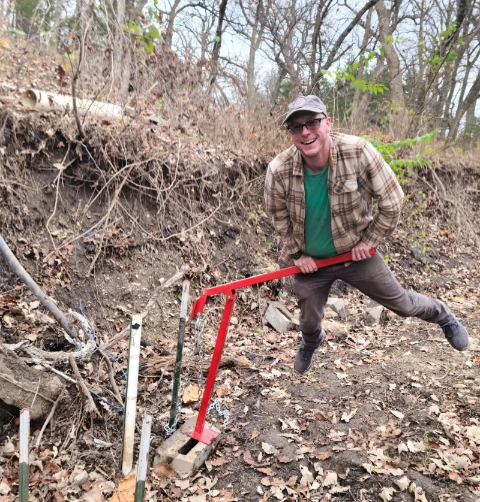
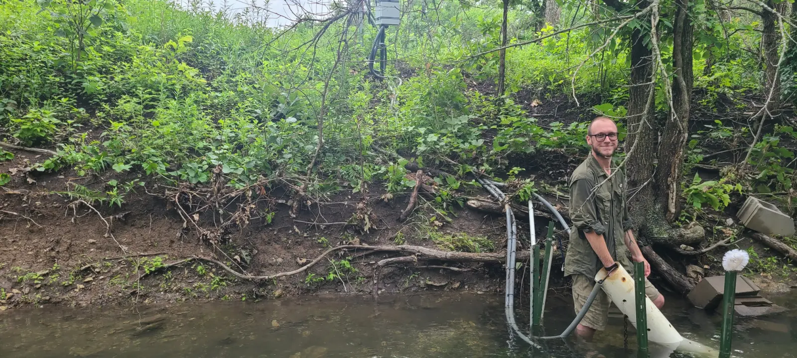

# Connor Brown

Aquatic Ecologist \| PhD Candidate \| \| He/Him

[![]()](https://github.com/ConnorB) [![]()](https://fediscience.org/@connor) [![]()](https://instagram.com/conbro_) [![]()](https://threads.com/@conbro_)  [![]()](https://x.com/eco_conn)  

I am a PhD Candidate at the [Kansas Geological Survey](https://kgs.ku.edu/water-resources-and-geohydrology) and [Department of Geology](https://geo.ku.edu) at the University of Kansas in [Dr. Erin Seybold’s](https://www.erinseybold.com/) lab, where I study ecosystem ecology and biogeochemical cycling in non-perennial streams as part of the Aquatic Intermittency Effects on Microbiomes in Streams (AIMS) project.

I previously completed an M.S. in Biology at Sam Houston State University, where I worked with [Dr. Amber Ulseth](https://nrri.umn.edu/faculty-staff/amber-j-ulseth-phd) on linking land use and precipitation regime changes to stream metabolism in subtropical Texas coastal streams. Before that, I earned a B.S. in Natural Resource Management (Fisheries and Aquatic Biology) at Texas Tech University, working with [Dr. Allison Pease](https://cafnr.missouri.edu/directory/allison-pease/) and [Dr. Kelbi Delaune](https://meadowsresearchinstitute.sulross.edu/people/kelbi-delaune-ph-d/) on Pecos River macroinvertebrate communities.

My research focuses on carbon cycling in non-perennial streams. I am broadly interested in stream ecosystem ecology, hydrology, biogeochemistry, and data science.

